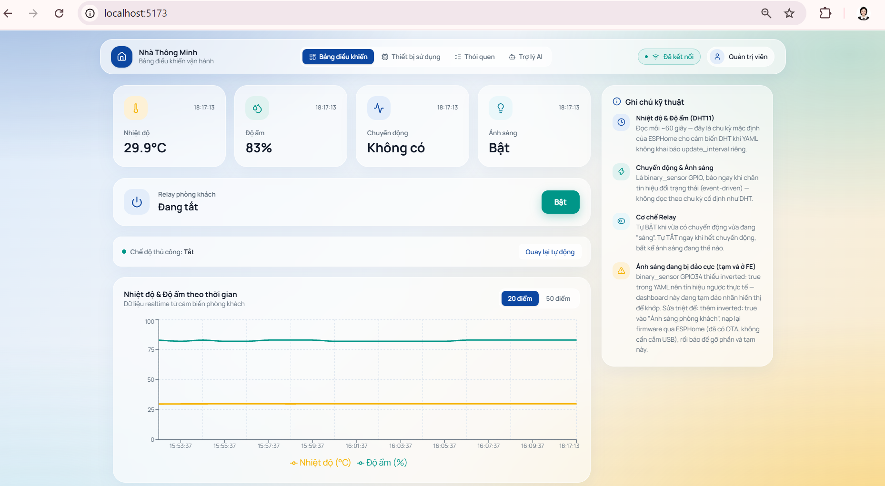
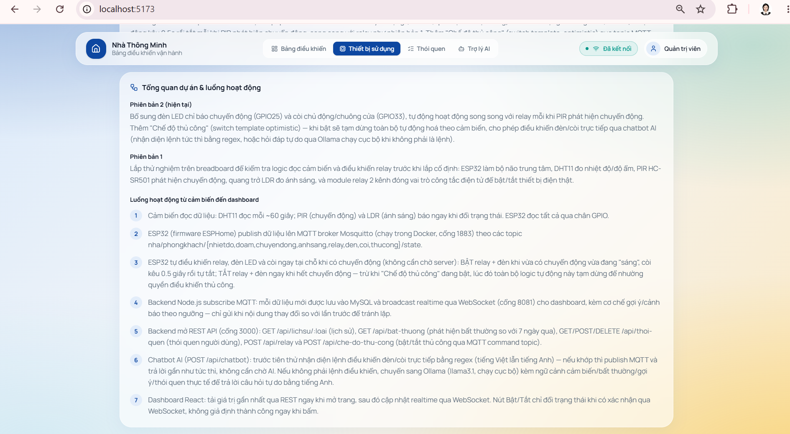
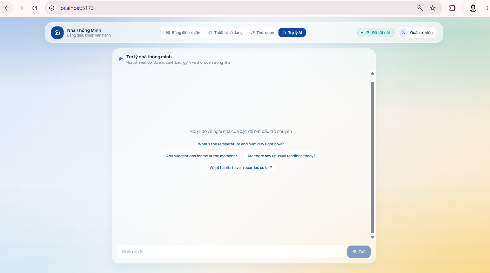
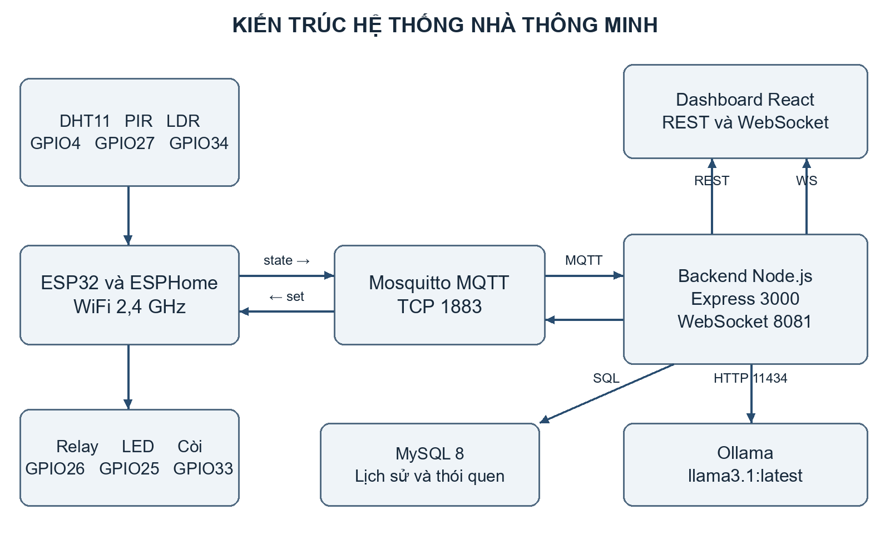
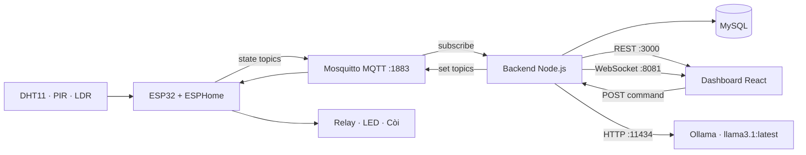

# Nhà thông minh IoT

> Hệ thống giám sát và điều khiển phòng khách theo thời gian thực với ESP32, ESPHome, MQTT, Node.js, MySQL và dashboard React.

[](./nha-thong-minh-dashboard)
[](./nha-thong-minh-backend)
[](./bao-cao/work/firmware-report.yaml)
[](#gi%E1%BB%9Bi-h%E1%BA%A1n-v%C3%A0-h%C6%B0%E1%BB%9Bng-ph%C3%A1t-tri%E1%BB%83n)

## 1. Tổng quan

Đây là mô hình nhà thông minh cho phòng khách. ESP32 đọc dữ liệu từ các cảm biến, gửi trạng thái qua MQTT; backend Node.js lưu lịch sử vào MySQL và phát dữ liệu realtime qua WebSocket; dashboard React hiển thị, điều khiển thiết bị và cung cấp trợ lý AI chạy cục bộ bằng Ollama.

Các chức năng chính:

- Giám sát nhiệt độ, độ ẩm, chuyển động và ánh sáng.
- Điều khiển relay, LED báo chuyển động và còi/chuông cửa.
- Tự động hóa theo chuyển động, ánh sáng và chế độ thủ công.
- Biểu đồ lịch sử 20/50 điểm đo gần nhất.
- Cảnh báo và gợi ý khi nhiệt độ/độ ẩm vượt ngưỡng.
- Quản lý thói quen người dùng và phát hiện một số dữ liệu bất thường.
- Chatbot điều khiển thiết bị hoặc hỏi đáp dựa trên dữ liệu trong nhà.

## 2. Ảnh giao diện

### Dashboard giám sát realtime



Dashboard hiển thị bốn thẻ cảm biến, trạng thái relay, chế độ thủ công, biểu đồ nhiệt độ/độ ẩm và ghi chú kỹ thuật.

### Trang thiết bị và luồng hoạt động



Trang thiết bị mô tả các phiên bản lắp ráp, linh kiện và luồng dữ liệu từ cảm biến đến dashboard.

### Trợ lý AI



Chatbot nhận câu hỏi tự nhiên; các lệnh bật/tắt đèn hoặc còi được nhận diện trực tiếp, các câu hỏi còn lại được xử lý bằng Ollama.

## 3. Kiến trúc hệ thống





Luồng xử lý tiêu biểu:

1. ESP32 đọc cảm biến và publish bản tin trạng thái lên Mosquitto.
2. Backend subscribe `nha/phongkhach/#`, lưu dữ liệu vào MySQL và broadcast qua WebSocket.
3. Dashboard tải dữ liệu ban đầu bằng REST, sau đó cập nhật realtime bằng WebSocket.
4. Khi người dùng điều khiển relay hoặc chatbot phát hiện lệnh, backend publish bản tin `set` về ESP32.

## 4. Thành phần phần cứng

| Thành phần | Chân GPIO | Vai trò |
|---|---:|---|
| DHT11 | GPIO4 | Đo nhiệt độ và độ ẩm |
| PIR HC-SR501 | GPIO27 | Phát hiện chuyển động |
| LDR / HW-072 | GPIO34 | Đo trạng thái ánh sáng |
| Relay 2 kênh | GPIO26 | Đóng/cắt thiết bị điện |
| LED báo chuyển động | GPIO25 | Báo trạng thái chuyển động |
| Còi chủ động | GPIO33 | Báo động/chuông cửa |

Firmware tham khảo nằm tại [`bao-cao/work/firmware-report.yaml`](bao-cao/work/firmware-report.yaml).

## 5. Topic MQTT

| Nhóm | Topic | Payload mẫu |
|---|---|---|
| Trạng thái | `nha/phongkhach/nhietdo/state` | `29.9` |
| Trạng thái | `nha/phongkhach/doam/state` | `83` |
| Trạng thái | `nha/phongkhach/chuyendong/state` | `ON` / `OFF` |
| Trạng thái | `nha/phongkhach/anhsang/state` | `ON` / `OFF` |
| Trạng thái | `nha/phongkhach/relay/state` | `ON` / `OFF` |
| Điều khiển | `nha/phongkhach/relay/set` | `ON` / `OFF` |
| Điều khiển | `nha/phongkhach/den/set` | `ON` / `OFF` |
| Điều khiển | `nha/phongkhach/coi/set` | `ON` / `OFF` |
| Điều khiển | `nha/phongkhach/thucong/set` | `ON` / `OFF` |

## 6. Công nghệ sử dụng

- **Firmware/IoT:** ESP32, ESPHome, Wi-Fi 2.4 GHz.
- **Message broker:** Mosquitto MQTT, cổng `1883`.
- **Backend:** Node.js, Express, MQTT.js, MySQL2, WebSocket (`ws`).
- **Frontend:** React 19, Vite, Tailwind CSS, Recharts, Lucide React.
- **AI cục bộ:** Ollama với model `llama3.1:latest`.

## 7. Cài đặt và chạy

### Yêu cầu

- Node.js 18+ và npm.
- Mosquitto đang chạy tại `mqtt://localhost:1883`.
- MySQL 8+ với database `nha_thong_minh`.
- Ollama và model `llama3.1:latest` nếu muốn dùng chatbot tự do.

### Khởi tạo database

Tạo database và hai bảng tối thiểu:

```sql
CREATE DATABASE nha_thong_minh CHARACTER SET utf8mb4 COLLATE utf8mb4_unicode_ci;
USE nha_thong_minh;

CREATE TABLE cam_bien_data (
  id INT AUTO_INCREMENT PRIMARY KEY,
  topic VARCHAR(255) NOT NULL,
  gia_tri VARCHAR(255) NOT NULL,
  thoi_gian DATETIME DEFAULT CURRENT_TIMESTAMP
);

CREATE TABLE thoi_quen_nguoi_dung (
  id INT AUTO_INCREMENT PRIMARY KEY,
  danh_muc VARCHAR(50) NOT NULL,
  noi_dung TEXT NOT NULL,
  ngay_tao DATETIME DEFAULT CURRENT_TIMESTAMP
);
```

### Chạy backend

```powershell
cd nha-thong-minh-backend
Copy-Item .env.example .env
# Mở .env và điền DB_PASSWORD nếu MySQL có mật khẩu
npm install
node index.js
```

Backend cung cấp REST API tại `http://localhost:3000` và WebSocket tại `ws://localhost:8081`.

### Chạy dashboard

Mở terminal khác:

```powershell
cd nha-thong-minh-dashboard
npm install
npm run dev
```

Truy cập địa chỉ Vite hiển thị trong terminal, thường là `http://localhost:5173`.

### Chạy Ollama (tùy chọn)

```powershell
ollama pull llama3.1:latest
ollama serve
```

## 8. API chính

| Method | Endpoint | Mục đích |
|---|---|---|
| `GET` | `/api/lichsu/:loai` | Lấy 50 bản ghi gần nhất của cảm biến/relay |
| `POST` | `/api/relay` | Bật/tắt relay |
| `GET` | `/api/bat-thuong` | Kiểm tra dữ liệu bất thường |
| `GET` | `/api/thoi-quen` | Lấy thói quen đã lưu |
| `POST` | `/api/thoi-quen` | Thêm thói quen |
| `DELETE` | `/api/thoi-quen/:id` | Xóa thói quen |
| `POST` | `/api/chatbot` | Hỏi chatbot hoặc gửi lệnh điều khiển |
| `POST` | `/api/che-do-thu-cong` | Bật/tắt chế độ thủ công |

## 9. Cấu trúc thư mục

```text
.
├── nha-thong-minh-backend/       # Node.js + Express + MQTT + MySQL + WebSocket
├── nha-thong-minh-dashboard/     # React + Vite dashboard
├── bao-cao/work/firmware-report.yaml
├── bao-cao/work/images/          # Ảnh giao diện, kiến trúc và kiểm thử
└── README.md
```

## 10. Giới hạn và hướng phát triển

- Cấu hình kết nối hiện đang dùng `localhost`, phù hợp cho demo trong mạng nội bộ.
- Nên bổ sung xác thực API, MQTT username/password và HTTPS khi triển khai thật.
- Có thể tách URL backend/WebSocket ra biến môi trường thay vì cố định trong frontend.
- Nên bổ sung migration/schema chính thức, kiểm thử tự động và cơ chế reconnect/health-check cho MySQL, MQTT và Ollama.

## Tài liệu liên quan

- [Dashboard React](nha-thong-minh-dashboard/)
- [Backend Node.js](nha-thong-minh-backend/)
- [Báo cáo hệ thống](bao-cao/Bao_cao_IoT_Nha_thong_minh_bo_sung_giao_dien.pdf)

